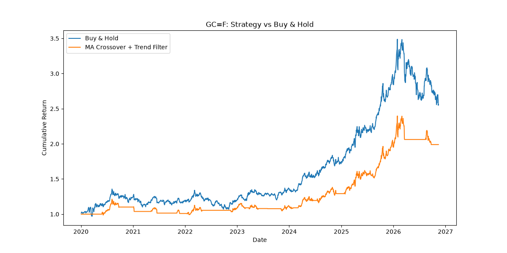

# Gold Futures Trading Strategy & Risk Analysis

## Overview

A Python-based quantitative trading project that
backtests a trend-following strategy on historical
gold futures prices (GC=F).

The strategy uses moving averages to identify
trading opportunities and evaluates performance
against a buy-and-hold benchmark.

## Technologies Used

- Python
- Pandas
- NumPy
- Matplotlib
- yfinance

## Trading Strategy

The strategy uses three technical indicators:

- 20-day SMA: Short-term moving average
- 50-day SMA: Medium-term moving average
- 100-day SMA: Long-term trend filter

### Trading Rules

**Long Signal:**
- 20-day SMA > 50-day SMA
- Gold price > 100-day SMA

**Exit Signal:**
- 20-day SMA <= 50-day SMA, or
- Gold price <= 100-day SMA

The strategy shifts trading signals by one day
to avoid using future information.

## Backtesting Methodology

1. Download historical gold futures price data.
2. Calculate the moving-average indicators.
3. Generate systematic trading signals.
4. Calculate daily and cumulative strategy returns.
5. Compare the strategy with buy-and-hold.
6. Evaluate Sharpe ratio and maximum drawdown.

## Risk Management and Analysis

### Sharpe Ratio

Evaluates historical returns relative to volatility.

### Maximum Drawdown

Measures the largest percentage decline from
a previous peak in strategy performance.

### Benchmark Comparison

Compares strategy performance with a passive
buy-and-hold investment in gold.

## Results

The backtest generates performance metrics and
a chart comparing the strategy and benchmark.



Results depend on the selected historical period.
The strategy does not guarantee future profitability.

## How to Run

### Install Dependencies

```bash
python -m pip install -r requirements.txt
```

### Execute the Strategy

```bash
python gold_strategy.py
```

## Limitations

- Transaction costs and slippage are not modeled.
- Futures contract rolling and margin are not modeled.
- Moving averages can produce false signals.
- Historical results do not predict future returns.

## Future Improvements

- Test alternative moving-average combinations.
- Introduce transaction costs.
- Compare risk-adjusted performance across periods.
- Expand analysis to other commodities.
